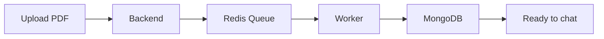
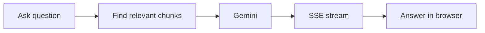

# FileMind - AI Document Q&A

FileMind lets users upload PDF documents and ask questions about their content. It uses React for the interface, Node.js and Express for the API, MongoDB for data, Redis for background jobs, and Google Gemini for embeddings, summaries, and answers.

## Main Features

- User registration and login with JWT authentication
- PDF upload and background processing
- Text extraction and overlapping text chunks
- Gemini embeddings stored in MongoDB
- Similarity search to find relevant document content
- AI answers based on uploaded documents
- Streaming chat responses with Server-Sent Events (SSE)
- Document summaries, chat history, and document search

## How FileMind Works

### PDF upload flow



In simple terms:

1. The React frontend sends the PDF to the Express backend.
2. The backend saves the file and puts a job in Redis.
3. Redis holds the job until the background worker is ready.
4. The worker extracts the PDF text and splits it into smaller chunks.
5. Gemini converts every chunk into a numerical vector called an embedding.
6. MongoDB stores the text chunks and their embeddings.
7. The document status changes from `Pending` to `Processing` and then to `Completed`.

### Question and answer flow



FileMind first finds relevant information in the user's documents and then sends that context to Gemini. If relevant information cannot be found, the application returns a fallback message instead of making up an answer.

### What each part does

| Part | Purpose |
| --- | --- |
| React and Vite | Displays the application and sends requests |
| Express and Node.js | Handles users, uploads, documents, and chat |
| Redis | Holds PDF processing jobs and job statuses |
| Background worker | Extracts text and creates embeddings |
| MongoDB | Stores users, documents, chunks, embeddings, and chats |
| Google Gemini | Creates embeddings, summaries, and AI answers |

## Quick Start

### Prerequisites

- Node.js 18 or newer
- MongoDB running at `mongodb://127.0.0.1:27017/filemind`
- Redis running at `127.0.0.1:6379`
- A Google Gemini API key

### Configure the backend

```bash
cd server
cp .env.example .env
```

Add your Gemini API key to `server/.env`:

```env
PORT=5001
MONGO_URI=mongodb://127.0.0.1:27017/filemind
JWT_SECRET=filemind_super_secret_jwt_key_2026
REDIS_HOST=127.0.0.1
REDIS_PORT=6379
GEMINI_API_KEY=YOUR_ACTUAL_GEMINI_API_KEY_HERE
UPLOAD_PATH=uploads/
```

### Start MongoDB and Redis

On macOS with Homebrew:

```bash
brew services start mongodb-community
brew services start redis
```

Check Redis:

```bash
redis-cli ping
```

The expected response is:

```text
PONG
```

### Start the application without Docker

Use separate terminals:

**Terminal 1 - backend**

```bash
cd server
npm install
npm run dev
```

**Terminal 2 - frontend**

```bash
cd client
npm install
npm run dev
```

The backend starts the PDF worker automatically. If you run a separate worker process instead, use this command and do not run a second worker from the backend:

```bash
cd server
npm run worker:dev
```

Open the application at:

```text
http://localhost:3000
```

## API Overview

### Authentication

- `POST /auth/register` - Create a user account
- `POST /auth/login` - Log in and receive a JWT
- `GET /auth/profile` - Get the logged-in user's profile
- `PUT /auth/profile` - Update the profile

### Documents

- `POST /documents/upload` - Upload a PDF and queue processing
- `GET /documents` - List the user's documents
- `GET /documents/:id` - Get document details
- `GET /documents/status/:id` - Get processing status
- `GET /documents/:id/search` - Search inside document chunks
- `DELETE /documents/:id` - Delete a document and related data

### Chat

- `POST /chat` - Ask a question and receive an SSE stream
- `GET /chat/history` - Get chat history
- `DELETE /chat/history` - Clear chat history

## Docker

Docker Compose can run the frontend, backend, worker, MongoDB, and Redis together:

```bash
docker compose up --build
```

Stop the services:

```bash
docker compose down
```

## Troubleshooting

1. **MongoDB connection failed:** Make sure MongoDB is running on port `27017`.
2. **Redis connection failed:** Run `redis-cli ping` and confirm that it returns `PONG`.
3. **Gemini errors:** Check that `GEMINI_API_KEY` is present in `server/.env` and that the key has access to the required Gemini models.

## License

MIT License. Designed and built for production RAG workflows.
